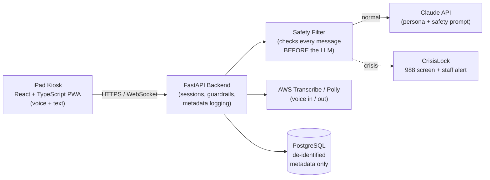

# MCI Companion — Clinical LLM Chatbot (Architecture Showcase)

An AI conversation companion for older adults with **Mild Cognitive Impairment
(MCI)**, built as a funded research-assistant project at Saint Louis
University's High Performance Computing Lab (advisor: Prof. Ted Ahn). The
system is the technical groundwork for a clinical feasibility pilot supporting
a future **NIH R01** application.

> **Why there is no code here.** The application code is private due to
> clinical-research constraints. This repository documents the **architecture,
> safety design, and engineering decisions**, with a demo of the working
> system running on dummy data (no PHI, no real patients).

## 🎬 Demo

iPad kiosk running a **hands-free voice conversation** on dummy data — the
companion speaks, the mic auto-opens (`Listening…`), speech is auto-transcribed
and answered, through the session close.

**▶ [Watch the full demo (2:44, MP4)](media/demo.mp4)** — proactive AI greeting
→ voice turn cycle → graceful session close.

## What it is

A kiosk-style iPad app + backend that delivers short, structured, voice-first
conversations — positive reminiscence, light cognitive engagement, emotional
support — to MCI patients, while collecting **only de-identified engagement
metadata** for the research team.

| | |
|---|---|
| Frontend | React + TypeScript PWA (iPad Safari kiosk, offline-tolerant, accessibility-first) |
| Backend | FastAPI + SQLAlchemy/Alembic |
| Database | PostgreSQL — de-identified metadata only |
| LLM | Commercial model via a provider-swappable client (Anthropic Claude; prompt-engineered, **no fine-tuning**) |
| Voice | AWS Transcribe (streaming STT) + AWS Polly (TTS), fully server-relayed |
| Deploy | Docker Compose, nginx, Let's Encrypt TLS, AWS EC2 + ECR, CI/CD via GitHub Actions (OIDC) + SSM (no SSH) |
| Status | Research prototype; participant pilot planned after IRB approval (no real participants or PHI yet) |

## Highlights

**🚨 Safety first — "Code Blue" crisis flow.**
Every participant message is scanned by a code-level crisis filter **before it
can reach the LLM** — keyword/pattern based, so it fires instantly even if the
model is down. On detection: the conversation halts, the UI locks to a 988
crisis screen (no back button), a safety event is recorded (only the triggering message is kept for staff review),
and staff are alerted off the critical path. Only a person can clear the lock, and
the AI second pass can only raise the risk level, never lower it. The LLM
prompt carries a matching behavioral contract as defense in depth.
→ [docs/safety-design.md](docs/safety-design.md)

**🎙️ Hands-free voice for older adults.**
Button-free turn cycle: the companion speaks (per-sentence streaming TTS — audio
starts on the first completed sentence), the mic auto-opens, on-device VAD
detects end-of-speech, and the transcript is sent through the same
safety-checked path as typed text. Latency engineering includes speculative
early STT (transcription overlaps the silence wait), silence-tail
trimming, and iOS mic ducking. Raw audio is **discarded after STT** — never
stored.
→ [docs/voice-pipeline.md](docs/voice-pipeline.md)

**🔒 Privacy by design.**
No names, DOBs, or transcripts in the database — participants are de-identified
UUIDs with birth decade only. Conversation text is never logged or written to the
database (long-term context sits in a per-participant model memory store with a
destruction path); at session close an LLM labelling pass writes back **labels
only** (topics, rough durations, clinical-domain flags). Designed toward a HIPAA/BAA deployment from day one.

**📊 Research operations built in.**
Coordinator dashboard (staff-authenticated, JWT) with engagement charts,
activity-status badges for RA follow-up calls, usage panels, and streamed
**de-identified CSV exports** for analysis. Device pairing ("1 iPad = 1
participant"), dosage guardrails (daily session/minute caps), topic rotation
with append-only history, and withdrawal flows that preserve data.

**🚢 Real deployment pipeline.**
`push to main` → CI (migrations + pytest on Postgres, lint + typecheck + Vitest
+ build) → images to ECR (git-SHA tagged) → SSM-triggered zero-SSH deploy →
TLS health check. Rollback = redeploy an older SHA.

**🧩 Prompts as reviewable config.**
Persona, always-on safety rules, participant context, a topic bank (5 domains,
14 categories), and a 5-minute wrap-up instruction are separate files assembled
per request, so the PI can review and edit them without touching code. LLM token
usage is logged per call and visible in the staff dashboard.

## How it was built (AI-driven development)

The code was written by a **Claude Code multi-agent team** (lead, server,
frontend, mobile, AI, QA): **184 PRs, 178 tasks, and about 43k lines across
backend, web, and mobile in five months.** I designed how the LLM is used in the
service and ran the team; requirements came from the PI and the study
coordinators.

- **Context design.** Each instruction is self-contained: background, the files
  and scope to touch, what not to touch, how to verify, and the PR steps.
  Architecture, DB, and API docs are maintained as agent context, and a task is
  not done until those docs are updated.
- **Team rules.** Folder ownership per role; one task, one branch, one PR; no
  test means not done; verify on a running server (through nginx), not only in
  unit tests; QA re-runs instead of trusting "done". By team rule, safety logic,
  session limits, and interface changes merge only after my review.
- **Automated gates.** CI runs backend, web, and mobile checks on every PR; dev
  deploys only after green CI; prod deploys only tags already verified on dev.
  Tests run in an isolated environment with real alerts and outside network
  blocked. CI guards catch missing route permissions and nginx allowlist entries.
- **Verifying the agents.** Running the PI's 15 crisis scenarios against the real
  model found a sentence that both the rules and the AI pass missed, which became
  a new pattern plus a regression scenario. A "mobile voice works" report turned
  out to have zero speech-to-text calls in the logs, so it became a separate
  device test. A deploy that broke every conversation turn was rolled back rather
  than patched on the live server, then diagnosed on a branch and reintroduced.

## Architecture (overview)

Full system design, data model, and identity/authorization model:
→ [docs/architecture.md](docs/architecture.md)

## Author

**Seung Bum Jung** — M.S. Computer Science, Saint Louis University (HPC Lab).
4+ years of production distributed systems (AWS) at Doverunner; research in
Federated Learning parallelization and clinical ML.
[GitHub](https://github.com/back99) ,
[LinkedIn](https://www.linkedin.com/in/seungbum-jung-6a105317a/) ,
seungbum.jung@slu.edu

*All personas and data shown anywhere in this repository are fictional. No PHI
is present in the system at this phase.*
