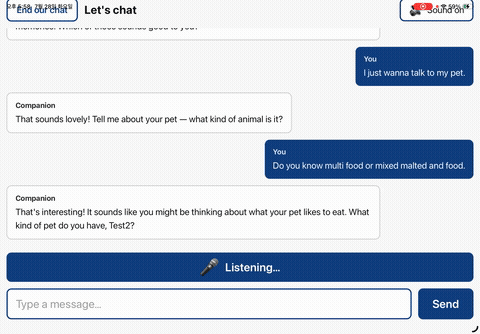
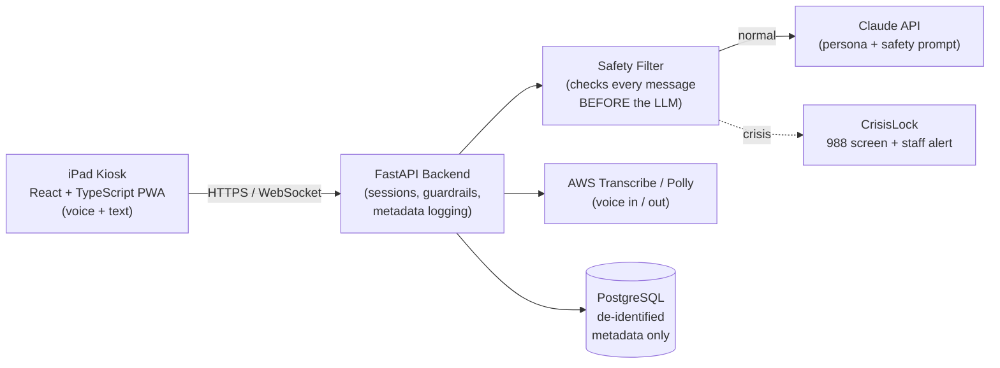

# MCI Companion — Clinical LLM Chatbot (Architecture Showcase)

An AI conversation companion for older adults with **Mild Cognitive Impairment
(MCI)**, built as a funded research-assistant project at Saint Louis
University's High Performance Computing Lab (advisor: Prof. Ted Ahn). The
system is the technical groundwork for a clinical feasibility pilot supporting
a future **NIH R01** application.

> **Why there is no code here.** The application code is private due to
> clinical-research constraints. This repository documents the **architecture,
> safety design, and engineering decisions**, with a demo of the working
> system running on dummy data (no PHI, no real patients).

## 🎬 Demo

iPad kiosk running a **hands-free voice conversation** on dummy data — the
companion speaks, the mic auto-opens (`Listening…`), speech is auto-transcribed
and answered, through the session close.

**▶ [Watch the full demo (2:44, MP4)](media/demo.mp4)** — proactive AI greeting
→ voice turn cycle → graceful session close.

## What it is

A kiosk-style iPad app + backend that delivers short, structured, voice-first
conversations — positive reminiscence, light cognitive engagement, emotional
support — to MCI patients, while collecting **only de-identified engagement
metadata** for the research team.

| | |
|---|---|
| Frontend | React + TypeScript PWA (iPad Safari kiosk, offline-tolerant, accessibility-first) |
| Backend | FastAPI + SQLAlchemy/Alembic |
| Database | PostgreSQL — de-identified metadata only |
| LLM | Commercial model via a provider-swappable client (Anthropic Claude; prompt-engineered, **no fine-tuning**) |
| Voice | AWS Transcribe (streaming STT) + AWS Polly (TTS), fully server-relayed |
| Deploy | Docker Compose · nginx · Let's Encrypt TLS · AWS ECR · CI/CD via GitHub Actions + SSM (no SSH) |
| Tests | **690+ automated tests** — pytest (backend) + Vitest (frontend), E2E smoke tests in CI |

## Highlights

**🚨 Safety first — "Code Blue" crisis flow.**
Every participant message is scanned by a code-level crisis filter **before it
can reach the LLM** — keyword/pattern based, so it fires instantly even if the
model is down. On detection: the conversation halts, the UI locks to a 988
crisis screen (no back button), a de-identified flag is recorded (timestamp
only — never content), and staff are alerted off the critical path. The LLM
prompt carries a matching behavioral contract as defense in depth.
→ [docs/safety-design.md](docs/safety-design.md)

**🎙️ Hands-free voice for older adults.**
Button-free turn cycle: the companion speaks (per-sentence streaming TTS — audio
starts on the first completed sentence), the mic auto-opens, on-device VAD
detects end-of-speech, and the transcript is sent through the same
safety-checked path as typed text. Latency engineering includes speculative
early STT (transcription overlaps the silence wait), prompt caching, silence-tail
trimming, and iOS mic ducking. Raw audio is **discarded after STT** — never
stored.
→ [docs/voice-pipeline.md](docs/voice-pipeline.md)

**🔒 Privacy by design.**
No names, DOBs, or transcripts in the database — participants are de-identified
UUIDs with birth decade only. Conversation content lives in memory for the
session and is never persisted or logged; at session close an LLM labelling
pass writes back **labels only** (topics, rough durations, clinical-domain
counts). Designed toward a HIPAA/BAA deployment from day one.

**📊 Research operations built in.**
Coordinator dashboard (staff-authenticated, JWT) with engagement charts,
activity-status badges for RA follow-up calls, usage panels, and streamed
**de-identified CSV exports** for analysis. Device pairing ("1 iPad = 1
participant"), dosage guardrails (daily session/minute caps), topic rotation
with append-only history, and withdrawal flows that preserve data.

**🚢 Real deployment pipeline.**
`push to main` → CI (migrations + pytest on Postgres, lint + typecheck + Vitest
+ build) → images to ECR (git-SHA tagged) → SSM-triggered zero-SSH deploy →
TLS health check. Rollback = redeploy an older SHA.

## Architecture (overview)

Full system design, data model, and identity/authorization model:
→ [docs/architecture.md](docs/architecture.md)

## Author

**Seung Bum Jung** — M.S. Computer Science, Saint Louis University (HPC Lab).
4+ years of production distributed systems (AWS) at Doverunner; research in
Federated Learning parallelization and clinical ML.
[GitHub](https://github.com/back99) ·
[LinkedIn](https://www.linkedin.com/in/seungbum-jung-6a105317a/) ·
seungbum.jung@slu.edu

*All personas and data shown anywhere in this repository are fictional. No PHI
is present in the system at this phase.*
