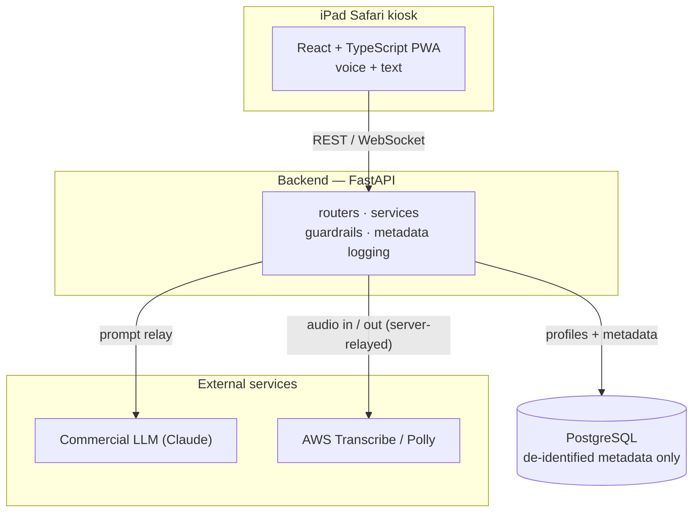
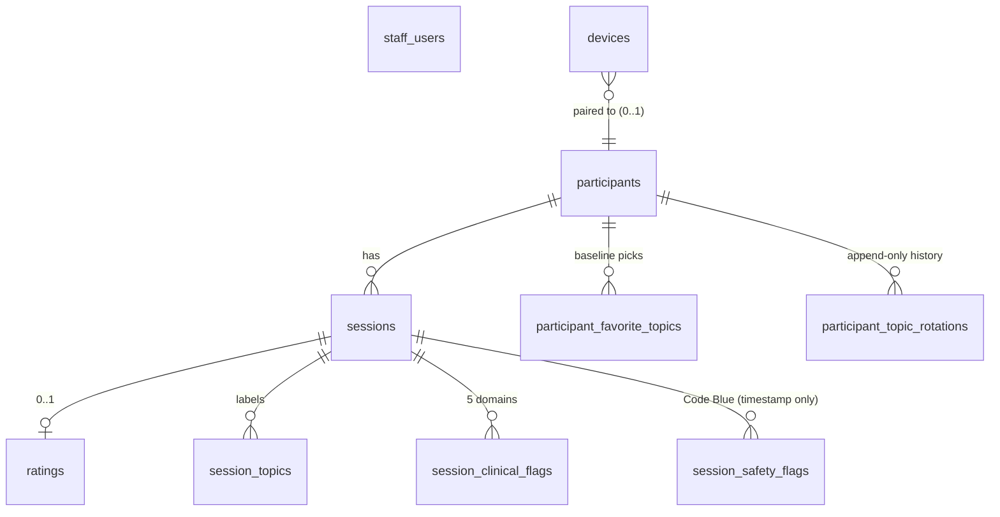
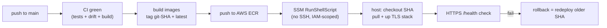

# System Architecture

Whole-system design for the MCI Companion — an AI conversation companion for
older adults with mild cognitive impairment, built for a university clinical
feasibility pilot (groundwork for a future NIH R01 application).

> **Phase:** dummy-data prototype. No PHI, no real patients. The HIPAA
> deployment (university ITS cloud + BAA) comes later, but the system is
> designed for it now: env-based secrets, profiles separated from logs,
> de-identified ids only.

**Companion docs:** [safety-design.md](safety-design.md) — the Code Blue crisis
flow · [voice-pipeline.md](voice-pipeline.md) — hands-free voice + latency
engineering.

---

## 1. System overview

Core stances, each of which shaped the design below:

- **No fine-tuning.** The companion is a commercial model steered by a system
  prompt assembled at request time from reviewable config files (persona +
  safety + the participant's topics + profile). Clinicians review behavior by
  reading Markdown, not code. The LLM client is provider-swappable (Anthropic
  today; another vendor is one subclass + one factory branch away).
- **Conversation content is never stored.** It exists in memory for the
  session only. At session close, an LLM labelling pass writes back *labels*:
  topics mapped to a preset catalog, rough durations, and clinical-domain
  counts. Never the text.
- **The companion always speaks first.** A code-level opening trigger
  guarantees it — the target population often won't initiate.
- **Dosage is a backend guarantee.** Two env-configurable daily caps (session
  count *and* total minutes); hitting either returns `429` at session start.
  The clinical schedule itself is an off-app protocol — the app never
  auto-invites (an earlier auto-invite feature was built and deliberately
  retired by study decision).

---

## 2. Backend design

**Layering.** `routers/` (HTTP/WS surface, status-code semantics) →
`services/` (domain logic: sessions, dosage, safety, authz, export,
notifications) → `models` + Alembic migrations (schema history) — with a
separate `llm/` package (client wrapper, prompt builder, safety filter, topic
catalog loader, metadata extractor, STT/TTS wrappers) fed by `prompts/`
config files. Prompt content and safety criteria are **data, not code**.

**Chat is a WebSocket state machine.** `WS /ws/chat/{participant_id}` (scoped
— see §5): on connect, the backend reads the profile + baseline topics, builds
the system prompt, and streams the companion's opening. Every inbound message
passes the **Code Blue filter before any LLM call** — a crisis closes the
conversation into a locked 988 screen and the message never reaches the model
([safety-design.md](safety-design.md)). Replies stream chunk-by-chunk so the
frontend can begin per-sentence TTS mid-turn.

**Error semantics are part of the API contract.** Selected examples:

| Behavior | Contract |
|---|---|
| Daily dosage reached | `POST /sessions` → `429` (count **or** minutes cap) |
| Deleting a participant who has data | `DELETE /participants/{id}` → `409` — must *withdraw* instead (data-preserving) |
| Kiosk touching another participant | `403`; unknown credentials `401` |
| Unknown/deleted device token | `GET /devices/me` → `404` — the kiosk discards its token and self-resets to the pairing screen |
| Rating overwrite | `POST .../rating` → `201` first write, `200` overwrite (0–5, incl. an explicit "Not at all" = 0 distinct from skip) |

**API surface** (~34 endpoints): auth, device pairing lifecycle
(register / pair / unpair / delete / reassign), participants (CRUD + status +
onboarding), sessions + ratings + metadata, topic catalog + baseline +
rotation history, admin reads, CSV exports, safety check, voice TTS/STT, and
the chat WebSocket. Every route is tagged staff-only 🔒, kiosk-scoped 📱, or
open — nothing is accidentally public.

---

## 3. Frontend design

**Folder discipline.** `pages/` (screens) vs `components/` (parts);
`api/` is the *only* module that talks to the server (typed fetch + WS URL —
base URL, headers, and error handling live in one place); `hooks/` hold
reusable behavior (`useChatSocket`, `useDevicePairing`, `useHandsFree`,
`useVoice`, `useSessionTimer`); `lib/` holds **framework-agnostic pure
functions** — VAD decisions, incremental sentence segmentation, engagement
aggregation, participant labels. The pure-function layer is a deliberate
testability decision: the trickiest logic (voice activity, chart math,
streaming segmentation) runs as plain unit-testable code with no DOM or
network.

**TypeScript strictness is enforced at build time** — `tsc -b` runs before the
production build, so a type error breaks the build, and API response types
mirror backend schemas.

**Connection resilience (the "never stuck thinking" rule).** The chat hook
arms a connect timeout and an opening timeout, treats pre-opening errors as
failed attempts, and reconnects with a short bounded backoff. When the budget
is exhausted it shows a gentle fallback line — never an infinite spinner.
Reconnects happen only before the first turn (no duplicate greeting), and a
reconnect **never replays participant messages** — so retry logic cannot
bypass safety screening.

**Accessibility as the core constraint:** elder-friendly type/touch tokens,
kiosk viewport (no pinch-zoom), safe-area insets, screen wake lock,
installable PWA verified standalone on a real iPad.

---

## 4. Data model

PostgreSQL holds **de-identified metadata only** — no names, DOBs, or PHI.
Display names are pseudonyms; same-named participants are disambiguated on
staff screens with a short-UUID chip.

Design details worth noting:

- **Two axes, never mixed:** *topic domains* (what to talk about — a curated
  14-category catalog across 5 domains, stored as config files with stable
  slugs) vs *clinical domains* (what to measure — sleep / anxiety /
  depression / cognition / loneliness, logged per session).
- **Integrity over trust:** LLM-estimated topic durations are clamped on
  write so a session's topic time can never exceed the session's real length
  — the display treats them as estimates rather than trusting a clockless
  model.
- **Append-only where history matters:** topic rotations are snapshots, never
  updates — the longitudinal flexibility data the study needs.
- **Withdraw ≠ delete:** deletion is allowed only for zero-session
  mis-registrations; participants with data can only be status-withdrawn,
  preserving everything.
- **Privacy invariant (non-negotiable):** `session_safety_flags` stores
  session id + timestamp only; the safety filter returns a boolean, never
  matched text; CSV exports exclude the Code Blue table.

---

## 5. Identity & authorization — two user types, two models

| Who | Identity | Mechanism |
|-----|----------|-----------|
| Participant | "1 iPad = 1 participant" — **never a password** | Device pairing: the kiosk self-registers on boot and shows a single-use, expiring pairing code; staff bind it to a participant. Thereafter a secret device token is the kiosk's *only* identity source |
| Staff / researcher | Real login | bcrypt + JWT (12h); every back-office route 401s without a token; SSO/IdP planned at deployment |

The pairing lifecycle is fully staff-operable: **unpair** drops the kiosk back
to a fresh setup code; **delete** makes the kiosk discard its dead token and
re-register; **reassign** moves a device between participants — all without
touching the device or clearing browser data.

Data-route scoping: participant/session/topic routes *and the chat WebSocket*
accept staff bearer **or** the paired device's token. Cross-participant access
→ `403`; unauthorized sockets are closed **before accept** (no LLM call).

---

## 6. Research operations

- **Visit-1 onboarding wizard** (participant-driven, once): catalog topic
  picks on elder-friendly tiles → voice + pace selection → a practice chat
  that is deliberately *not* a session (no records, no rating, no dosage).
- **Topic lifecycle:** baseline favorites → periodic refresh (the picker
  re-appears every N days with picks pre-checked; confirming resets the
  clock) → automatic recovery if a catalog revision retires every favorite a
  participant had (forced re-selection instead of topic-less chats).
- **Coordinator dashboard** (staff-only, read-only): cohort + per-participant
  engagement charts, activity badges (Today / N-days / Never — telling the RA
  who to phone), usage panels whose formulas match the CSV export, session
  detail with Code Blue badges, and status management (active / dropout
  candidate / withdrawn).
- **CSV exports:** streamed, de-identified (`text/csv`) — one row per session
  and one per participant, with date-range and participant filters; the
  study's analysis deliverable.

---

## 7. Quality & delivery

**Testing (690+ automated tests).**

| Layer | What runs |
|---|---|
| Pure units | VAD decisions, sentence segmentation, engagement math, prompt builder, safety filter patterns |
| API tests | pytest against real Postgres with migrations applied + schema-drift check |
| E2E smoke (backend) | login → register → pair → session → metadata → rating → end → read-back |
| E2E smoke (frontend) | pairing → onboarding → welcome → chat → soft-close → rating, plus the Code Blue lock and practice-chat-is-not-a-session |

CI runs all of it on every PR (backend job + lint/typecheck/Vitest/build job).
LLM and network are stubbed in tests — no keys required.

**Delivery.**

- **No SSH anywhere.** GitHub's credentials can only push to ECR and invoke
  SSM; the host pulls from ECR with its own IAM role, so no cloud keys live on
  the box.
- **Runtime:** Docker Compose (nginx-served SPA + FastAPI + Postgres with a
  persistent volume), WebSocket-aware reverse proxy, Let's Encrypt TLS with
  auto-renew (HTTPS is also what unlocks the browser mic), auto-restart on
  reboot. Local dev remains a single `docker compose up` with no cloud
  dependencies.

---

## 8. Selected engineering decisions

A sample of the project's decision log — each entry recorded with rationale at
the time it was made:

| Decision | Rationale |
|---|---|
| Crisis filter returns a bare boolean | Matched text can never leak into logs or the DB — privacy enforced by signature, not by discipline |
| Per-sentence streaming TTS implemented entirely in the frontend | The WebSocket protocol stayed unchanged, so the safety-checked input path could not regress |
| Chat model: fast small model → stronger model | After the latency work absorbed the slower first token, comprehension won the trade-off — a measured decision, not a default |
| Dual dosage caps (sessions **and** minutes), env-driven | Clinical dosage is a study parameter; ops can tune it without a deploy, and `0` disables cleanly |
| Clamp LLM-estimated topic durations on write | Don't trust a clockless model with integrity constraints; keep raw estimates visibly labelled as estimates |
| WS reconnects only before the first turn, never replaying messages | Resilience must not create duplicate greetings — or a path around safety screening |
| Withdraw ≠ delete | Research data is preserved by construction; deletion exists only for zero-data mis-registrations |
| Device pairing is the kiosk's single identity source | The old dev override was removed entirely — one code path, no identity ambiguity |
| Prompts and topic catalog as reviewable config files | Clinician sign-off happens on Markdown; behavior changes are reviewable diffs |
| Auto-invite feature built, then retired by study decision | The protocol owns scheduling; the app enforces only the dosage guarantee — deleting working code was the right call |

---

## 9. Privacy & deployment posture

- **Now:** prototype with fictional personas; no PHI anywhere in code, tests,
  fixtures, or logs. Secrets live in env files (git-ignored).
- **Designed for later:** HIPAA deployment under a BAA on university-managed
  cloud — de-identified ids, profiles separated from logs, env-based secrets,
  provider-swappable LLM, and clinician-reviewable prompt config were all
  chosen with that destination in mind.
