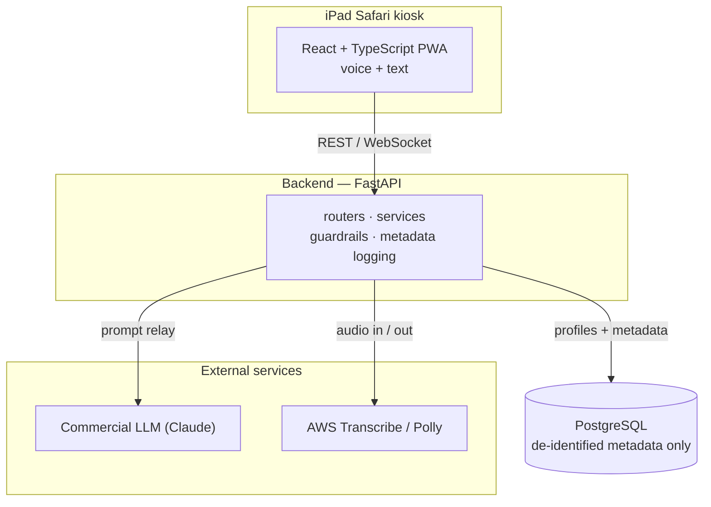
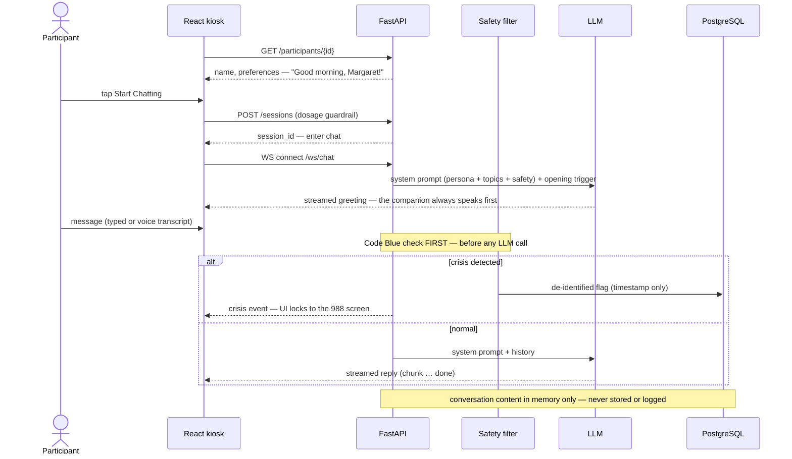

# System Architecture

Whole-system design for the MCI Companion — an AI conversation companion for
older adults with mild cognitive impairment, built for a university clinical
feasibility pilot.

> **Phase:** dummy-data prototype. No PHI, no real patients. The HIPAA
> deployment (university ITS cloud + BAA) comes later, but the system is
> designed for it now: env-based secrets, profiles separated from logs,
> de-identified ids only.

## 1. System overview



Key stances:

- **No fine-tuning.** The companion is a commercial model steered by a system
  prompt assembled from reviewable config files (persona + safety) — clinicians
  can review behavior without reading code. Provider-swappable LLM client
  (Anthropic today; another vendor is one subclass away).
- **Conversation content is never stored.** It exists in memory for the
  session; at close, an LLM labelling pass writes back topics (mapped to a
  preset catalog), rough durations, and clinical-domain counts — labels only.
- **Voice audio is discarded after STT** (see
  [voice-pipeline.md](voice-pipeline.md)).
- Sessions: ~10–15 minutes, with backend-enforced daily dosage caps
  (sessions/day and minutes/day, env-configurable).

## 2. Conversation flow



The companion **opens every conversation** (a code-level opening trigger
guarantees it) and leads proactively — greeting warmly, offering topic choices,
inviting reminiscence — because the target population often won't initiate.

## 3. Identity & authorization — two user types, two models

| Who | Identity | Mechanism |
|-----|----------|-----------|
| Participant | "1 iPad = 1 participant" — **never a password** | Software device pairing: the kiosk registers on boot and staff pair it on screen (single-use, expiring pairing codes; secret device token thereafter). MDM single-app lock + biometric unlock arrive with managed devices |
| Staff / researcher | Real login | bcrypt + JWT; all back-office routes 401 without a token; SSO/IdP planned at deployment |

Data-route scoping: participant, session, and topic routes — including the
chat WebSocket — are scoped to *staff or the paired device*. Cross-participant
access returns 403; unknown credentials 401.

## 4. Onboarding & research operations

- **Visit-1 wizard (participant-driven):** pick favorite topics from a preset
  catalog (elder-friendly tiles) → choose voice + pace → practice chat that is
  deliberately *not* a session (no records, no dosage).
- **Topic system:** a curated catalog (14 categories across 5 topic domains) as
  reviewable config files; participant favorites + append-only rotation
  history; a periodic refresh re-shows the picker with current picks
  pre-checked; a recovery path forces re-selection if a catalog revision
  retires all of a participant's picks.
- **Coordinator dashboard (staff-only, read-only):** engagement charts (cohort
  + per-participant), activity-status badges that tell the RA who to phone,
  usage panels, session detail with Code Blue badges, and streamed
  de-identified **CSV exports** (one row per session / per participant).
- **Lifecycle:** zero-session mis-registrations can be deleted; participants
  with data can only be *withdrawn* (status change — data preserved). A
  "dropout candidate" badge flags inactivity for review; withdrawal is always
  a manual staff decision.

## 5. Data model

PostgreSQL holds **de-identified metadata only** — no names, DOBs, or PHI.
Display names are pseudonyms; same-named participants are disambiguated with a
short-UUID chip.

```
participants 1:N sessions
participants 1:N participant_favorite_topics   (catalog slug refs)
participants 1:N participant_topic_rotations   (append-only history)
sessions     1:0..1 ratings                    (0–5, incl. explicit "Not at all")
sessions     1:N session_topics                (labels + clamped durations)
sessions     1:N session_clinical_flags        (5 measurement domains)
sessions     1:N session_safety_flags          (Code Blue: timestamp only)
```

Integrity details: topic durations are clamped so a session's topic time can
never exceed its real length; clinical-domain flags are measurement metadata
(sleep / anxiety / depression / cognition / loneliness) — a different axis from
conversation topics.

## 6. Quality & delivery

- **690+ automated tests**: pytest (backend, run against real Postgres with
  migrations in CI) + Vitest (frontend), plus E2E smoke tests covering
  login → register → pair → session → metadata → rating → read-back, and the
  kiosk flow including the Code Blue lock.
- **CI** on every PR: migrations + schema-drift check + pytest; lint +
  typecheck + Vitest + build.
- **CD**: push to main → CI green → images built and pushed to ECR (git-SHA +
  latest) → an SSM-triggered script on the host pulls and restarts the TLS
  stack → health check. **No SSH anywhere**; the host pulls from ECR with its
  own IAM role, so no cloud keys live on the box. Rollback = redeploy an older
  SHA.
- **Runtime:** Docker Compose (web / backend / db), nginx serving the SPA and
  reverse-proxying REST + WebSocket, Let's Encrypt TLS with auto-renewal
  (HTTPS is also required for browser mic access), auto-restart on reboot with
  a persistent data volume.

## 7. Privacy & deployment posture

- **Now:** prototype with fictional personas; no PHI anywhere in code, tests,
  fixtures, or logs. Secrets live in env files (git-ignored).
- **Designed for later:** HIPAA deployment under a BAA on university-managed
  cloud — de-identified ids, profiles separated from logs, env-based secrets,
  provider-swappable LLM, and clinician-reviewable prompt config were all
  chosen with that destination in mind.
