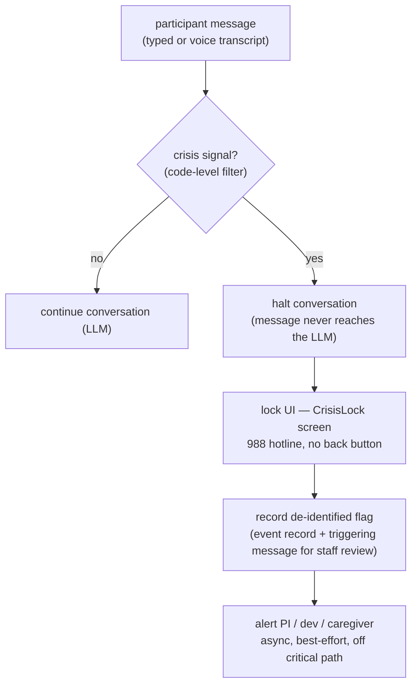

# Safety Design — the "Code Blue" Crisis Flow

The most important feature in the system. If a participant's message shows
suicidal ideation or acute crisis: **halt, lock, show the hotline, alert.**
Never weakened, never bypassed.

## Design principles

1. **Code before model.** Detection is a code-level keyword/pattern filter that
   runs **before any LLM call**. It fires instantly, costs nothing, and works
   even if the model provider is down. The LLM is a second layer, not the first.
2. **Content can never leak.** The filter returns a bare boolean — never the
   matched text — so conversation content cannot reach logs or the database.
3. **The critical path stays short.** Locking the UI and recording the flag
   happen synchronously; alerting staff happens on a background thread,
   best-effort, so a failed email/SMS can never delay the 988 screen.

## Flow

## Detection coverage

Beyond literal phrases, the filter handles:

- **Typos & STT mishearings** — the voice path feeds transcripts through the
  same filter, so common speech-to-text distortions of crisis phrases are
  covered.
- **Indirect / euphemistic phrasing** — e.g. "my life isn't worth living",
  future-tense and colloquial ideation.
- **Separator obfuscation** — e.g. "s u i c i d e".
- **Deliberate exclusions** — physical-pain and medication phrasings that are
  *non-crisis* for this population, and idioms ("I could kill for a coffee"),
  excluded via word-boundary matching to keep false positives low. Every
  inclusion/exclusion decision is recorded in a decision log.

## Alerting

Provider-swappable notification channel (console / SMTP / Twilio — env-config
only). The alert body is de-identified: participant UUID + time + "Code Blue".
Never the message, keyword, or category.

## Storage & visibility

- Safety events keep only the message that triggered them (for staff review); no other conversation text is stored.
- Staff dashboards surface a read-only "Code Blue occurred" badge per session —
  closing the gap where crises were recorded but invisible.
- The research CSV export **excludes** the Code Blue table entirely.

## Defense in depth

A behavioral safety contract (`safety.md`, reviewable config — not code) is
included in **every** system prompt, instructing the model how to behave around
crisis topics — so even content that passes the filter meets a second, model-
level layer.

## Governance

Prompts are config data (`.md`/`.yaml`) reviewable by clinicians without
touching code. By team rule, changes to the crisis flow are merged only after human review; clinical
judging criteria for metadata extraction are maintained as reviewable drafts
pending PI/clinician sign-off.
