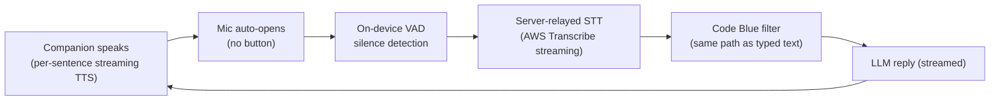

# Voice Pipeline — Hands-Free Conversation for Older Adults

Voice is the primary interface: many MCI participants won't type. The design
goal is a **button-free conversation loop** that feels natural at slow speech
pace, on an iPad, with every safety guarantee intact.

## The hands-free loop

- **Auto-play, auto-listen.** Each companion turn speaks automatically; when
  the reply finishes draining, the mic opens by itself. Speak/Listen buttons
  were removed entirely — with text input and an idle "Tap to talk" fallback.
- **Voice activity detection** runs on-device (pure decision function + Web
  Audio), with env-tunable thresholds set generously for slow speech.
- **Barge-in protection:** the mic never records while the companion is
  speaking; on iOS the mic is ducked during companion speech to defeat
  Safari's audio attenuation.

## Latency engineering

Perceived latency is the difference between "a conversation" and "a loading
screen" for this population. Optimizations, each measured on the real device
path:

| Technique | Effect |
|---|---|
| **Per-sentence streaming TTS** | Speech starts on the *first completed sentence* of the LLM stream, not the full reply; synthesis overlaps playback of earlier clips via an ordered audio queue |
| **Speculative early STT** | Transcription starts *during* the VAD silence wait, overlapping the confirmation window instead of following it |
| **Prompt caching** | The stable system-prompt prefix is cached at the provider, cutting first-token time |
| **Silence-tail trimming** | The trailing silence the VAD needed is trimmed before upload — less audio to transcribe |
| **AWS client singletons** | No per-request client construction on the hot path |
| **Model choice** | Evaluated a faster small model for latency; reverted to a stronger model (comprehension over speed) once the latency work above absorbed the slower first token — an explicit, measured trade-off |

## Privacy guarantees

- **Server-relayed only.** The iPad never talks to AWS directly; audio goes to
  the backend, which streams to Transcribe/Polly. No cloud credentials on the
  device.
- **Audio is discarded after STT.** Temp files are deleted in `finally`;
  streaming transcription avoids intermediate object storage entirely.
- **Transcripts follow the safety path.** A voice turn becomes a normal chat
  message — running the same Code Blue filter before any LLM call.
- **Nothing voice-related is persisted** — not audio, not transcripts; only
  the same de-identified session metadata as text chats.

## Accessibility details

- Voice + pace chosen by the participant during onboarding (with preview);
  playback rate applied per participant.
- Remembered sound on/off preference; autoplay unlocked on the session-start
  tap (iOS Safari policy) via a shared primed audio element.
- HTTPS/TLS everywhere — required for browser mic access — with certificates
  auto-renewed.
